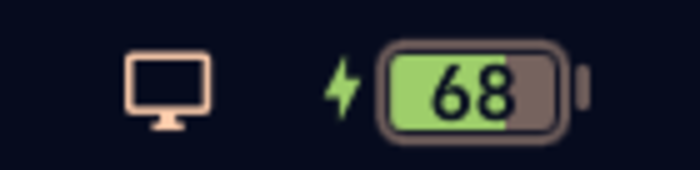

# Power Inside

The Omarchy power widget with the battery percentage rendered **inside** the
battery icon — iOS/macOS style — instead of beside it.



The built-in `omarchy.power` shows `81% 󰂄` as text next to a glyph. This plugin
draws the number *inside* a battery-shaped capsule: solid fill for charge
level, digits knocked out of the fill, a bolt marker while plugged in.

## What it does

- Percentage number inside the battery icon; digits stay legible at any level
- Bolt marker beside the icon while on AC power
- Charging shimmer animation across the fill
- Fill turns the theme's urgent color at ≤ 20% while discharging
- Breathe/pulse animation at critical level
- Everything the stock power widget does: charge level, capacity, cycles,
  rate, remaining time, power-profile picker (left click)
- Follows the active theme; the only fixed color is the charging green

## Install

```bash
omarchy plugin add https://github.com/jacker-nz/omarchy-power-inside --enable
```

The manifest declares `omarchy.clonedFrom: "omarchy.power"`, so it takes the
built-in power widget's slot in the bar and disables it — nothing to move
manually. Set `"showPercentage": true` on the bar entry (or right-click the
icon) for the in-icon mode; `false` falls back to the plain glyph.

## Remove

```bash
omarchy plugin disable jacker-nz.power-inside
omarchy plugin remove jacker-nz.power-inside
```

Disabling or removing restores the built-in `omarchy.power` widget.

## Files

```
manifest.json   plugin manifest (id: jacker-nz.power-inside, clonedFrom: omarchy.power)
Panel.qml       bar widget + power panel
Model.js        helpers (unchanged from stock omarchy.power)
```

## Requirements

- Omarchy with the Quickshell shell (Quattro era)
- `upower` (already part of Omarchy)

## License

MIT — see [LICENSE](LICENSE)
